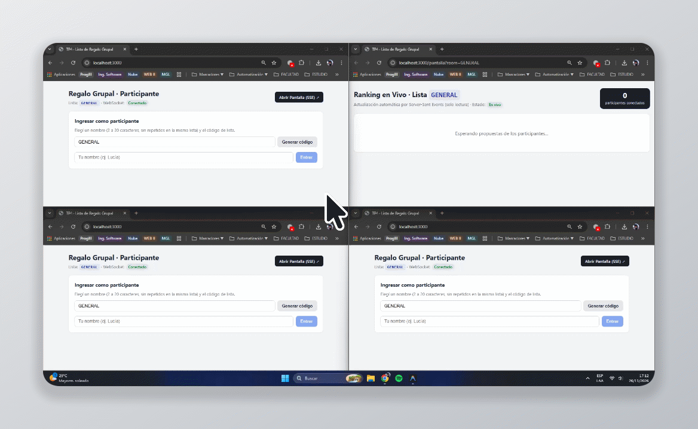
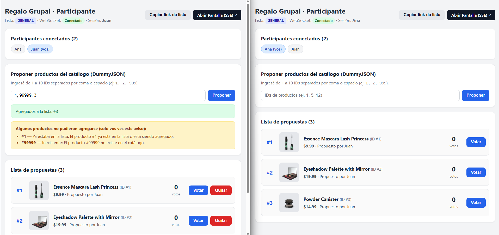
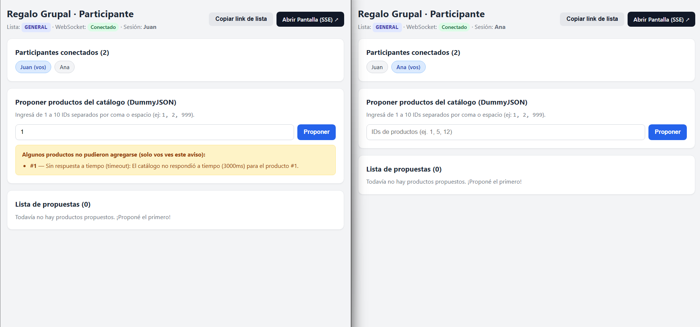
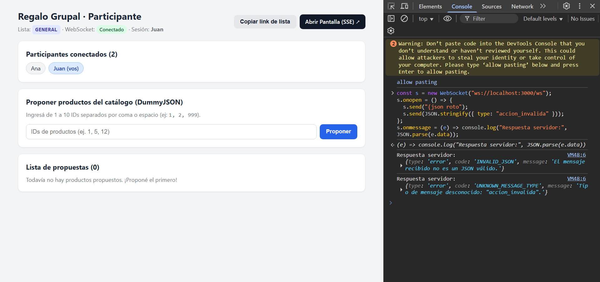

# TP4 · Lista Compartida de Regalo Grupal en Tiempo Real

**Repositorio:** [https://github.com/GeroA6/WEB-II-TP-4](https://github.com/GeroA6/WEB-II-TP-4)

Aplicación web en tiempo real construida con **Node.js (LTS)**, **TypeScript**, **WebSocket estándar (`ws`)**, **Server-Sent Events (`EventSource`)** y **React + Vite**, integrada de forma asíncrona con el catálogo externo **DummyJSON**.

Un único servidor Node.js, en un único puerto, sirve:
- La vista de **Participante** (`/` o `/?room=<CODIGO>`), comunicada por **WebSocket** (`/ws?room=<CODIGO>`).
- La vista de **Pantalla compartida** (`/pantalla` o `/pantalla?room=<CODIGO>`), comunicada por **Server-Sent Events** (`/events?room=<CODIGO>`).
- El endpoint de diagnóstico (`/health`).

> La aplicación no utiliza base de datos: el estado vive en la memoria del servidor mientras está en ejecución.

## Índice
1. [Instalación y ejecución](#1-instalación-y-ejecución)
2. [Configuración y simulación de catálogo lento](#2-configuración-y-simulación-de-catálogo-lento)
3. [Contrato de mensajes y eventos](#3-contrato-de-mensajes-y-eventos)
4. [Decisiones de diseño y justificación](#4-decisiones-de-diseño-y-justificación)
5. [Qué ve cada usuario cuando el catálogo falla o tarda](#5-qué-ve-cada-usuario-cuando-el-catálogo-falla-o-tarda)
6. [Por qué WebSocket para Participantes, SSE para Pantalla y no Polling](#6-por-qué-websocket-para-participantes-sse-para-pantalla-y-no-polling)
7. [Opcionales implementados](#7-opcionales-implementados)
8. [Guía de pruebas y evidencias](#8-guía-para-probar-los-7-escenarios-y-tomar-evidencias) ([Ver capturas y GIF](#evidencias))
9. [Documentación educativa por módulo](#9-documentación-educativa-por-módulo)

---

## 1. Instalación y ejecución

### Requisitos
- **Node.js** versión LTS (desarrollado y probado con Node `v22.19.0`).
- **npm** (incluido con Node.js).

### Instalación y arranque
```bash
git clone https://github.com/GeroA6/WEB-II-TP-4.git
cd WEB-II-TP-4
npm install
npm run build
npm start
```

Al iniciar, el servidor queda escuchando en un único puerto (por defecto `3000`):
- **Participante:** `http://localhost:3000/`
- **Pantalla (SSE):** `http://localhost:3000/pantalla`
- **WebSocket:** `ws://localhost:3000/ws`
- **SSE stream:** `http://localhost:3000/events`
- **Salud/configuración:** `http://localhost:3000/health`

Si `HOST=0.0.0.0` (valor por defecto), la consola imprime también las URLs de tu red local (`http://<IP-LAN>:3000/`) para conectarte desde un celular u otro dispositivo en el mismo Wi-Fi.

### Scripts disponibles
| Script | Descripción |
| --- | --- |
| `npm run build` | Compila el servidor TypeScript (`dist/server/`) y el frontend React (`dist/client/`). |
| `npm start` | Ejecuta el servidor compilado leyendo `.env` si existe. |
| `npm run dev` | Ejecuta el servidor backend en modo watch con `tsx`. |
| `npm run dev:client` | Ejecuta Vite en modo desarrollo con proxy hacia `localhost:3000`. |
| `npm run typecheck` | Verifica tipos de TypeScript tanto en el servidor como en React. |
| `npm test` | Ejecuta las 30 pruebas automatizadas (9 suites) con `node:test`. |

---

## 2. Configuración y simulación de catálogo lento

Toda configuración se realiza mediante variables de entorno (o un archivo `.env` basado en `.env.example`), **sin modificar el código**:

| Variable | Default | Descripción |
| --- | --- | --- |
| `HOST` | `0.0.0.0` | Interfaz de escucha (`0.0.0.0` habilita acceso LAN; `127.0.0.1` solo local). |
| `PORT` | `3000` | Puerto único del servidor HTTP + WebSocket + SSE. |
| `CATALOG_URL` | `https://dummyjson.com/products` | URL base del catálogo externo. |
| `CATALOG_TIMEOUT_MS` | `3000` | Tiempo máximo de espera (ms) por cada consulta al catálogo. |
| `CATALOG_DELAY_MS` | `0` | Demora artificial (ms) enviada a DummyJSON mediante `?delay=<ms>`. |
| `WS_HEARTBEAT_MS` | `15000` | Intervalo (ms) de `ping`/`pong` para detectar conexiones muertas (`0` desactiva). |

### Cómo simular un catálogo lento sin modificar el código

**En PowerShell (Windows):**
```powershell
# Demora de 2000ms (responde dentro del timeout de 3000ms: ideal para comprobar que los demás siguen votando)
$env:CATALOG_DELAY_MS="2000"; npm start

# Demora de 4500ms (supera el timeout de 3000ms: dispara error de tipo "timeout")
$env:CATALOG_DELAY_MS="4500"; npm start
```

**En Bash (Linux / macOS):**
```bash
CATALOG_DELAY_MS=2000 npm start
CATALOG_DELAY_MS=4500 npm start
```

---

## 3. Contrato de mensajes y eventos

Todos los mensajes son **JSON**, tienen un campo discriminador `type` y están tipados en `shared/protocol.ts` (compartido entre el servidor y React). El servidor valida defensivamente todo mensaje entrante en tiempo de ejecución (`server/src/validation.ts`).

### Modelos compartidos

```ts
interface Participant {
  id: string;
  name: string;
}

interface ProductItem {
  id: number;
  title: string;
  price: number;
  thumbnail: string;
  proposedById: string;
  proposedByName: string;
  voterIds: string[];
  voteCount: number;
}

interface ProposalFailure {
  productId: number;
  reason: "not_found" | "timeout" | "already_exists" | "catalog_error";
  message: string;
}
```

### A. Mensajes Cliente → Servidor (WebSocket `/ws?room=<CODIGO>`)

| `type` | Campos | Cuándo se envía | Validación en el servidor |
| --- | --- | --- | --- |
| `join` | `name: string`, `participantId?: string` | Al ingresar con un nombre o al reconectar automáticamente. | `name` recortado (`trim`) de 2 a 20 caracteres, único en la sala (insensible a mayúsculas). `participantId` opcional de 8 a 64 caracteres `[a-zA-Z0-9_-]`. |
| `propose_products` | `productIds: number[]` | Al proponer de 1 a 10 productos por sus IDs de DummyJSON. | Arreglo de 1 a 10 enteros positivos. Requiere haber hecho `join`. |
| `vote` | `productId: number` | Al votar un producto de la lista. | Entero positivo, producto existente, participante unido y sin voto previo en ese producto. |
| `unvote` | `productId: number` | Al retirar el voto propio de un producto. | Entero positivo, producto existente, participante unido y con voto previo en ese producto. |
| `remove_product` | `productId: number` | Al quitar un producto de la lista. | Entero positivo, producto existente y el solicitante debe ser quien lo propuso. |

**Ejemplos JSON (Cliente → Servidor):**
```json
{ "type": "join", "name": "Lucía" }
{ "type": "propose_products", "productIds": [1, 2, 99999] }
{ "type": "vote", "productId": 1 }
{ "type": "unvote", "productId": 1 }
{ "type": "remove_product", "productId": 1 }
```

### B. Mensajes Servidor → Participante (WebSocket `/ws?room=<CODIGO>`)

| `type` | Alcance | Campos | Cuándo se envía |
| --- | --- | --- | --- |
| `welcome` | Unicast (solo emisor) | `roomCode`, `self`, `participants`, `products` | Inmediatamente después de un `join` válido. Entrega el estado completo actual sin esperar nuevos cambios. |
| `participants_updated` | Broadcast en la sala | `participants: Participant[]` | Cuando un participante entra o se desconecta (incluyendo cierre de pestaña o timeout de `ping`/`pong`). |
| `products_updated` | Broadcast en la sala | `products: ProductItem[]` | Cuando se agregan productos válidos, se vota, se retira un voto o se quita un producto. Siempre llega ordenado por `voteCount` descendente. |
| `proposal_result` | Unicast (solo emisor) | `addedIds: number[]`, `failures: ProposalFailure[]` | Al finalizar las consultas simultáneas de `propose_products`. Los errores/fallos parciales nunca se difunden a otros usuarios. |
| `error` | Unicast (solo emisor) | `code: ErrorCode`, `message: string` | Ante cualquier mensaje inválido (JSON roto, tipo desconocido, campos fuera de rango) o acción no permitida por las reglas de negocio. Nunca hace caer el servidor. |

**Códigos de error (`ErrorCode`):**
`INVALID_JSON`, `INVALID_MESSAGE`, `UNKNOWN_MESSAGE_TYPE`, `INVALID_NAME`, `NAME_TAKEN`, `NOT_JOINED`, `ALREADY_JOINED`, `PRODUCT_NOT_FOUND`, `FORBIDDEN`, `INVALID_VOTE_ACTION`.

**Ejemplos JSON (Servidor → Participante):**
```json
{
  "type": "proposal_result",
  "addedIds": [1, 2],
  "failures": [
    {
      "productId": 99999,
      "reason": "not_found",
      "message": "El producto #99999 no existe en el catálogo."
    }
  ]
}
```
```json
{
  "type": "error",
  "code": "UNKNOWN_MESSAGE_TYPE",
  "message": "Tipo de mensaje desconocido: \"foo\"."
}
```

### C. Eventos Servidor → Pantalla (SSE `GET /events?room=<CODIGO>`)

La pantalla se conecta con `EventSource` y **nunca envía datos al servidor**. Recibe un único tipo de evento nombrado:

| Evento SSE | Dirección | Campos de `data` (JSON) | Cuándo se envía |
| --- | --- | --- | --- |
| `event: state` | Servidor → Pantalla (de esa sala) | `roomCode: string`, `products: ProductItem[]`, `participantCount: number` | 1) Inmediatamente al abrir la conexión SSE.<br>2) Ante cualquier cambio en participantes (alta/baja) o productos (alta/voto/unvote/eliminación) dentro de la misma sala. |

**Formato real enviado por el stream `text/event-stream`:**
```text
event: state
data: {"roomCode":"GENERAL","products":[...],"participantCount":3}

```

---

## 4. Decisiones de diseño y justificación

1. **Nombres de participantes aceptados:**
   - *Regla:* no vacíos, se recortan espacios sobrantes (`trim`), longitud entre **2 y 20 caracteres**, y **sin repetidos entre participantes actualmente conectados en la misma sala** (comparación insensible a mayúsculas: `"Ana"` y `"ana"` se consideran el mismo nombre).
   - *Por qué:* evita nombres vacíos o excesivamente largos que rompan la interfaz y previene confusión sobre quién propuso o está conectado. Al validar solo contra conectados, si alguien sale puede volver a ingresar con su nombre.
2. **Productos repetidos y concurrencia:**
   - *Regla:* un mismo `productId` no puede aparecer dos veces en la lista. Antes de consultar DummyJSON, el servidor realiza una **reserva síncrona atómica** (`tryReserveProductId`) sobre un conjunto `inFlightProductIds`.
   - *Por qué:* aunque Node.js ejecuta en un solo hilo, las operaciones `async/await` se intercalan al esperar red. Sin reserva en vuelo, dos participantes proponiendo el producto `#5` al mismo tiempo pasarían ambos la verificación inicial y crearían un duplicado. Con la reserva, el primero consulta y agrega el producto, y el segundo recibe `already_exists` al instante sin disparar una consulta redundante. Si el catálogo falla o vence el timeout, la reserva se libera para permitir reintentos futuros.
3. **Quién puede quitar un producto:**
   - *Regla:* **solo el participante que propuso el producto** puede quitarlo, validado estrictamente en el servidor mediante `proposedById === requesterId` (encapsulado como estrategia `RemovalPolicy` siguiendo el principio Open/Closed).
   - *Por qué:* evita que otros participantes borren propuestas ajenas por error. Además, con la persistencia de `participantId` al reconectar, el autor conserva este permiso si recarga o sufre un microcorte de red.
4. **Tiempo máximo de espera del catálogo (`CATALOG_TIMEOUT_MS = 3000 ms`):**
   - *Por qué:* 3 segundos es lo suficientemente holgado para respuestas normales de DummyJSON (~200–800 ms en una conexión doméstica), pero lo bastante acotado para no dejar al usuario esperando indefinidamente ante una degradación del servicio externo, y facilita demostrar timeouts con `CATALOG_DELAY_MS=4000` o `4500`. Cada consulta usa su propio `AbortController` con `clearTimeout` en `finally` y todas las consultas de una propuesta se lanzan en simultáneo con `Promise.allSettled`.

---

## 5. Qué ve cada usuario cuando el catálogo falla o tarda

| Escenario | Quien hizo la propuesta | Demás participantes | Pantalla (SSE) |
| --- | --- | --- | --- |
| **Catálogo lento dentro del timeout** (ej. `delay=2000ms`, `timeout=3000ms`) | El botón muestra *"Consultando catálogo..."* mientras espera; al terminar recibe `proposal_result` y ve los productos agregados. | **No se bloquean:** siguen votando, retirando votos y viendo cambios con normalidad durante la espera; cuando los productos se confirman reciben `products_updated`. | Sigue recibiendo en vivo los votos y altas/bajas de conectados; apenas se confirman los productos, recibe `event: state` con la lista actualizada. |
| **Catálogo supera el timeout** (ej. `delay=4500ms`, `timeout=3000ms`) | Recibe `proposal_result` con `reason: "timeout"` para cada ID que venció el tiempo límite. La reserva en vuelo se libera. | No reciben ningún error ajeno; la lista permanece intacta. | No recibe errores; permanece sin cambios. |
| **Propuesta con fallos parciales** (ej. `[1, 99999, 1]`) | Los válidos (`#1`) se agregan normalmente y recibe `proposal_result` listando `#1` como agregado y los motivos exactos de cada fallo (`not_found`, `already_exists`, `timeout`, `catalog_error`). | Solo ven el producto válido (`#1`) agregado a la lista mediante `products_updated`; nunca ven los errores ajenos. | Recibe `event: state` con el producto válido (`#1`) incluido en el ranking. |

---

## 6. Por qué WebSocket para Participantes, SSE para Pantalla y no Polling

- **Participantes → WebSocket (`/ws`):** necesitan comunicación **bidireccional y frecuente** sobre una conexión persistente (envían `join`, `propose_products`, `vote`, `unvote`, `remove_product` y reciben actualizaciones instantáneas de estado y errores privados). WebSocket nativo evita la sobrecarga de cabeceras HTTP en cada acción y mantiene la asociación directa entre socket y sesión.
- **Pantalla → Server-Sent Events (`/events`):** es un cliente **estrictamente unidireccional** (solo lee el ranking y la cantidad de conectados; nunca envía mensajes). SSE funciona sobre HTTP estándar (`text/event-stream`), es más simple y liviano que WebSocket para tráfico Servidor → Cliente y ofrece reconexión automática nativa mediante `EventSource`.
- **¿Qué cambiaría si la pantalla usara Polling (`setInterval` + `fetch`)?**
  1. **Latencia artificial:** la pantalla siempre estaría desfasada hasta el siguiente intervalo de consulta (por ejemplo, 2–5 segundos de retraso tras cada voto).
  2. **Tráfico y carga innecesarios:** enviaría peticiones HTTP repetitivas incluso cuando nadie está interactuando, desperdiciando ancho de banda y CPU en el servidor.
  3. **Compromiso difícil:** bajar el intervalo (ej. cada 300 ms) mejora la frescura pero multiplica la carga HTTP; subirlo ahorra recursos pero degrada la experiencia en vivo. Con SSE el servidor solo escribe cuando ocurre un cambio real.

---

## 7. Opcionales implementados

Además de todos los requisitos obligatorios, se implementaron los **5 opcionales** propuestos en la consigna (documentados en detalle en `docs/modulos/modulo-09-opcionales.md`):

1. **Pruebas automatizadas con `node:test`:** 30 pruebas en 9 suites (`validation`, `store`, `proposalService`, `catalogClient`, `wsGateway`, `sseBroker`, `staticFiles`, `network`, `roomManager`).
2. **Conexión desde otro dispositivo de la misma red (LAN):** `HOST=0.0.0.0` por defecto, descubrimiento automático de IPs IPv4 locales en consola y URLs relativas en el frontend.
3. **Reconexión automática del participante:** *exponential backoff* (`1s → 2s → 4s → 5s`) y persistencia de `{ id, name, roomCode }` en `sessionStorage`, recuperando nombre, lista, votos previos y permiso de autor para quitar productos.
4. **Detección de conexiones muertas con `ping` y `pong`:** *heartbeat* configurable (`WS_HEARTBEAT_MS`) que detecta sockets *half-open* y los limpia automáticamente.
5. **Varias listas independientes con código:** soporte de salas aisladas (`?room=<CODIGO>`, por defecto `GENERAL`), generador de códigos y botón para copiar el link de invitación.

---

## 8. Guía para probar los 7 escenarios y tomar evidencias

Con `npm run build && npm start`, abrí **3 pestañas** en `http://localhost:3000/` (Ana, Juan, Sofía) y **1 pestaña** en `http://localhost:3000/pantalla`:

1. **Entrada tardía:** Ana propone `1, 2` y vota `1`. Luego entra Sofía y verifica que ve la lista completa y a todos los conectados al instante.
2. **Fallos parciales:** Ana propone `3, 99999, 1`. Verifica que `#3` se agrega para todos y **solo Ana** ve el aviso de `#99999` (*Inexistente*) y `#1` (*Ya estaba en la lista*). *(Sacar captura aquí).*
3. **Catálogo lento sin bloqueos:** reiniciá el servidor con `$env:CATALOG_DELAY_MS="2500"; npm start`. Ana propone `4, 5`; mientras espera, Juan vota un producto existente y tanto Juan como Sofía y la Pantalla ven el voto al instante. *(Sacar captura aquí).*
4. **Concurrencia:** dos participantes proponen el mismo ID casi a la vez (sin duplicado) o votan a la vez (se cuentan ambos votos).
5. **Cierre de pestaña:** cerrá la pestaña de Sofía; Ana, Juan y la Pantalla muestran inmediatamente un participante menos.
6. **Mensaje inválido desde la consola del navegador (F12 → Console):**
   ```js
   const s = new WebSocket("ws://localhost:3000/ws");
   s.onopen = () => {
     s.send("{json roto");
     s.send(JSON.stringify({ type: "accion_invalida" }));
   };
   s.onmessage = (e) => console.log("Respuesta servidor:", JSON.parse(e.data));
   ```
   El emisor recibe los mensajes `error` (`INVALID_JSON` y `UNKNOWN_MESSAGE_TYPE`) y el servidor sigue funcionando sin afectar a nadie. *(Sacar captura aquí).*
7. **Pantalla en vivo:** comprobar que `/pantalla` actualiza el ranking y la cantidad de participantes sin recargar.

### Evidencias

#### 1. Sincronización en vivo (3 participantes + pantalla SSE)


*(Si GitHub no previsualiza el GIF automáticamente por su tamaño, podés abrirlo directo en [docs/evidencias/demo-sincronizacion.gif](docs/evidencias/demo-sincronizacion.gif)).*

#### 2. Propuesta con fallos parciales


#### 3. Comportamiento con catálogo lento (sin bloqueos)


#### 4. Respuesta del servidor a mensajes inválidos desde consola


---

## 9. Documentación educativa por módulo

El desarrollo paso a paso (decisiones, arquitectura SOLID y verificaciones) está documentado en:
- `docs/roadmap.md`
- `docs/modulos/modulo-01-arquitectura-y-entorno.md` a `docs/modulos/modulo-09-opcionales.md`
